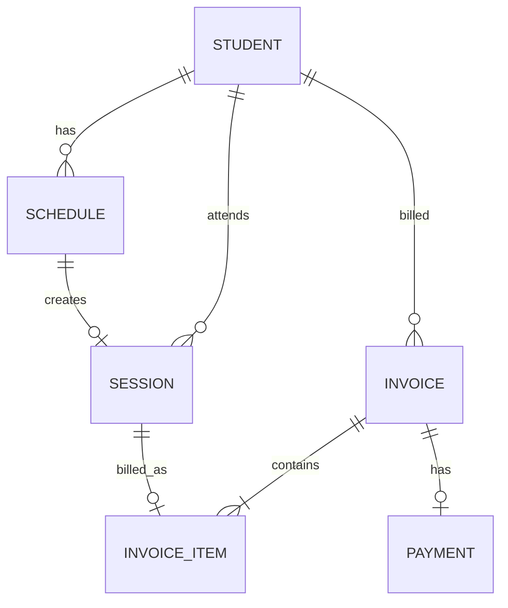

# Private Tutor MVP — Technical Blueprint

## 1. Scope

Flow utama aplikasi:

```text
Student
  ↓
Schedule
  ↓
Start Session
  ↓
Attendance
  ↓
Session Report
  ↓
Complete Session
  ↓
Billing Rule Check
  ↓
Auto Generate Invoice
  ↓
Parent Payment
  ↓
Mark as Paid
```

Aplikasi bersifat:

```text
Local Only

No Backend
No Login
No Firebase
No GPS
No Payment Gateway
```

---

# 2. Recommended Architecture

Untuk Compose Multiplatform:

```text
Compose UI
   ↓
ViewModel
   ↓
Use Case
   ↓
Repository
   ↓
Local Database
```

Struktur sederhana:

```text
presentation
    ↓
domain
    ↓
data
```

---

# 3. Core Entities

Entity utama:

```text
Student
Schedule
Session
Invoice
InvoiceItem
Payment
```

Relasi:



---

# 4. Student

Student menyimpan data siswa sekaligus konfigurasi billing.

```kotlin
data class Student(
    val id: Long,
    val name: String,
    val parentName: String?,
    val parentPhone: String?,
    val subject: String,
    val pricePerSession: Long,
    val billingInterval: Int,
    val createdAt: Long
)
```

Contoh:

```text
Budi

Parent:
Ibu Ani

Phone:
08123456789

Subject:
Matematika

Price:
Rp150.000 / session

Billing:
Every 4 sessions
```

---

# 5. Schedule

```kotlin
data class Schedule(
    val id: Long,
    val studentId: Long,
    val scheduledDate: Long,
    val startTime: Long,
    val endTime: Long?,
    val subject: String,
    val price: Long,
    val status: ScheduleStatus,
    val createdAt: Long
)
```

Status:

```kotlin
enum class ScheduleStatus {
    SCHEDULED,
    IN_PROGRESS,
    COMPLETED,
    CANCELLED
}
```

Flow:

```text
SCHEDULED
    ↓
IN_PROGRESS
    ↓
COMPLETED
```

atau:

```text
SCHEDULED
    ↓
CANCELLED
```

---

# 6. Session

Session adalah hasil aktual dari sebuah Schedule.

```kotlin
data class Session(
    val id: Long,
    val scheduleId: Long,
    val studentId: Long,

    val startedAt: Long,
    val endedAt: Long?,

    val subject: String,

    val topic: String?,
    val progress: StudentProgress?,
    val notes: String?,
    val homework: String?,

    val price: Long,

    val status: SessionStatus,
    val billingStatus: SessionBillingStatus,

    val createdAt: Long
)
```

Session status:

```kotlin
enum class SessionStatus {
    IN_PROGRESS,
    COMPLETED,
    CANCELLED
}
```

Billing status:

```kotlin
enum class SessionBillingStatus {
    UNBILLED,
    BILLED
}
```

Progress:

```kotlin
enum class StudentProgress {
    NEEDS_IMPROVEMENT,
    FAIR,
    GOOD,
    VERY_GOOD
}
```

---

# 7. Invoice

```kotlin
data class Invoice(
    val id: Long,
    val studentId: Long,

    val invoiceNumber: String,

    val totalAmount: Long,

    val status: InvoiceStatus,

    val createdAt: Long,
    val dueAt: Long?,
    val paidAt: Long?
)
```

Status:

```kotlin
enum class InvoiceStatus {
    UNPAID,
    PAID
}
```

---

# 8. Invoice Item

Jangan menyimpan hanya total invoice.

Invoice harus mengetahui sesi mana saja yang ditagihkan.

```kotlin
data class InvoiceItem(
    val id: Long,

    val invoiceId: Long,
    val sessionId: Long,

    val description: String,
    val amount: Long
)
```

Contoh:

```text
INV-2026-0001

Session 1
03 Sep
Rp150.000

Session 2
07 Sep
Rp150.000

Session 3
10 Sep
Rp150.000

Session 4
14 Sep
Rp150.000

Total
Rp600.000
```

---

# 9. Payment

```kotlin
data class Payment(
    val id: Long,

    val invoiceId: Long,

    val amount: Long,

    val paymentMethod: PaymentMethod,

    val paidAt: Long,

    val note: String?
)
```

Payment method:

```kotlin
enum class PaymentMethod {
    BANK_TRANSFER,
    CASH,
    QRIS,
    OTHER
}
```

---

# 10. SQLDelight Tables

Untuk Compose Multiplatform, SQLDelight cocok karena bisa digunakan Android dan iOS.

## Student.sq

```sql
CREATE TABLE student (
    id INTEGER NOT NULL PRIMARY KEY AUTOINCREMENT,

    name TEXT NOT NULL,

    parent_name TEXT,
    parent_phone TEXT,

    subject TEXT NOT NULL,

    price_per_session INTEGER NOT NULL,

    billing_interval INTEGER NOT NULL DEFAULT 1,

    created_at INTEGER NOT NULL
);
```

Queries:

```sql
getStudents:
SELECT *
FROM student
ORDER BY name ASC;

getStudentById:
SELECT *
FROM student
WHERE id = ?;

insertStudent:
INSERT INTO student(
    name,
    parent_name,
    parent_phone,
    subject,
    price_per_session,
    billing_interval,
    created_at
)
VALUES (?, ?, ?, ?, ?, ?, ?);

updateStudent:
UPDATE student
SET
    name = ?,
    parent_name = ?,
    parent_phone = ?,
    subject = ?,
    price_per_session = ?,
    billing_interval = ?
WHERE id = ?;

deleteStudent:
DELETE FROM student
WHERE id = ?;
```

---

# 11. Schedule.sq

```sql
CREATE TABLE schedule (
    id INTEGER NOT NULL PRIMARY KEY AUTOINCREMENT,

    student_id INTEGER NOT NULL,

    scheduled_date INTEGER NOT NULL,

    start_time INTEGER NOT NULL,

    end_time INTEGER,

    subject TEXT NOT NULL,

    price INTEGER NOT NULL,

    status TEXT NOT NULL,

    created_at INTEGER NOT NULL,

    FOREIGN KEY(student_id)
        REFERENCES student(id)
        ON DELETE CASCADE
);
```

Queries:

```sql
getScheduleById:
SELECT *
FROM schedule
WHERE id = ?;

getSchedules:
SELECT *
FROM schedule
ORDER BY start_time ASC;

getSchedulesByStudent:
SELECT *
FROM schedule
WHERE student_id = ?
ORDER BY start_time DESC;

getSchedulesByDate:
SELECT *
FROM schedule
WHERE scheduled_date = ?
ORDER BY start_time ASC;
```

---

# 12. Session.sq

```sql
CREATE TABLE session (
    id INTEGER NOT NULL PRIMARY KEY AUTOINCREMENT,

    schedule_id INTEGER NOT NULL,

    student_id INTEGER NOT NULL,

    started_at INTEGER NOT NULL,

    ended_at INTEGER,

    subject TEXT NOT NULL,

    topic TEXT,

    progress TEXT,

    notes TEXT,

    homework TEXT,

    price INTEGER NOT NULL,

    status TEXT NOT NULL,

    billing_status TEXT NOT NULL DEFAULT 'UNBILLED',

    created_at INTEGER NOT NULL,

    FOREIGN KEY(schedule_id)
        REFERENCES schedule(id)
        ON DELETE CASCADE,

    FOREIGN KEY(student_id)
        REFERENCES student(id)
        ON DELETE CASCADE
);
```

Important query:

```sql
getCompletedUnbilledSessions:
SELECT *
FROM session
WHERE student_id = ?
AND status = 'COMPLETED'
AND billing_status = 'UNBILLED'
ORDER BY ended_at ASC;
```

Set billed:

```sql
markSessionAsBilled:
UPDATE session
SET billing_status = 'BILLED'
WHERE id = ?;
```

---

# 13. Invoice.sq

```sql
CREATE TABLE invoice (
    id INTEGER NOT NULL PRIMARY KEY AUTOINCREMENT,

    student_id INTEGER NOT NULL,

    invoice_number TEXT NOT NULL UNIQUE,

    total_amount INTEGER NOT NULL,

    status TEXT NOT NULL DEFAULT 'UNPAID',

    created_at INTEGER NOT NULL,

    due_at INTEGER,

    paid_at INTEGER,

    FOREIGN KEY(student_id)
        REFERENCES student(id)
        ON DELETE CASCADE
);
```

Queries:

```sql
getInvoices:
SELECT *
FROM invoice
ORDER BY created_at DESC;

getInvoiceById:
SELECT *
FROM invoice
WHERE id = ?;

getUnpaidInvoices:
SELECT *
FROM invoice
WHERE status = 'UNPAID'
ORDER BY created_at DESC;
```

---

# 14. InvoiceItem.sq

```sql
CREATE TABLE invoice_item (
    id INTEGER NOT NULL PRIMARY KEY AUTOINCREMENT,

    invoice_id INTEGER NOT NULL,

    session_id INTEGER NOT NULL,

    description TEXT NOT NULL,

    amount INTEGER NOT NULL,

    FOREIGN KEY(invoice_id)
        REFERENCES invoice(id)
        ON DELETE CASCADE,

    FOREIGN KEY(session_id)
        REFERENCES session(id)
        ON DELETE CASCADE
);
```

Query:

```sql
getInvoiceItems:
SELECT *
FROM invoice_item
WHERE invoice_id = ?;
```

---

# 15. Payment.sq

```sql
CREATE TABLE payment (
    id INTEGER NOT NULL PRIMARY KEY AUTOINCREMENT,

    invoice_id INTEGER NOT NULL,

    amount INTEGER NOT NULL,

    payment_method TEXT NOT NULL,

    paid_at INTEGER NOT NULL,

    note TEXT,

    FOREIGN KEY(invoice_id)
        REFERENCES invoice(id)
        ON DELETE CASCADE
);
```

---

# 16. Recommended Domain Structure

```text
domain
│
├── model
│   ├── Student.kt
│   ├── Schedule.kt
│   ├── Session.kt
│   ├── Invoice.kt
│   ├── InvoiceItem.kt
│   └── Payment.kt
│
├── repository
│   ├── StudentRepository.kt
│   ├── ScheduleRepository.kt
│   ├── SessionRepository.kt
│   ├── InvoiceRepository.kt
│   └── PaymentRepository.kt
│
└── usecase
    ├── student
    ├── schedule
    ├── session
    ├── billing
    └── payment
```

---

# 17. Repository Interfaces

## StudentRepository

```kotlin
interface StudentRepository {

    fun observeStudents(): Flow<List<Student>>

    suspend fun getStudent(
        id: Long
    ): Student?

    suspend fun createStudent(
        student: Student
    )

    suspend fun updateStudent(
        student: Student
    )

    suspend fun deleteStudent(
        id: Long
    )
}
```

---

## ScheduleRepository

```kotlin
interface ScheduleRepository {

    fun observeSchedules(): Flow<List<Schedule>>

    fun observeSchedulesByDate(
        date: Long
    ): Flow<List<Schedule>>

    suspend fun getSchedule(
        id: Long
    ): Schedule?

    suspend fun createSchedule(
        schedule: Schedule
    )

    suspend fun updateStatus(
        scheduleId: Long,
        status: ScheduleStatus
    )
}
```

---

## SessionRepository

```kotlin
interface SessionRepository {

    suspend fun startSession(
        scheduleId: Long
    ): Long

    suspend fun completeSession(
        session: Session
    )

    suspend fun getCompletedUnbilledSessions(
        studentId: Long
    ): List<Session>

    suspend fun markAsBilled(
        sessionId: Long
    )
}
```

---

## InvoiceRepository

```kotlin
interface InvoiceRepository {

    fun observeInvoices(): Flow<List<Invoice>>

    fun observeUnpaidInvoices(): Flow<List<Invoice>>

    suspend fun getInvoice(
        invoiceId: Long
    ): Invoice?

    suspend fun createInvoice(
        invoice: Invoice,
        items: List<InvoiceItem>
    ): Long

    suspend fun markAsPaid(
        invoiceId: Long,
        paidAt: Long
    )
}
```

---

# 18. Important Use Cases

Minimum use case yang menurutku perlu:

```text
CreateStudentUseCase

CreateScheduleUseCase

StartSessionUseCase

CompleteSessionUseCase

GenerateInvoiceUseCase

CheckBillingRuleUseCase

RecordPaymentUseCase
```

---

# 19. Start Session Use Case

Flow:

```text
Schedule
   ↓
validate schedule
   ↓
Create Session
   ↓
Set startedAt
   ↓
Session = IN_PROGRESS
   ↓
Schedule = IN_PROGRESS
```

Pseudo code:

```kotlin
class StartSessionUseCase(
    private val scheduleRepository: ScheduleRepository,
    private val sessionRepository: SessionRepository
) {

    suspend operator fun invoke(
        scheduleId: Long
    ): Long {

        val schedule =
            scheduleRepository.getSchedule(scheduleId)
                ?: error("Schedule not found")

        val sessionId =
            sessionRepository.startSession(
                scheduleId = schedule.id
            )

        scheduleRepository.updateStatus(
            scheduleId = schedule.id,
            status = ScheduleStatus.IN_PROGRESS
        )

        return sessionId
    }
}
```

---

# 20. Complete Session Use Case

Ini salah satu flow paling penting.

```text
Complete Session

↓

Save Report

↓

Session COMPLETED

↓

Schedule COMPLETED

↓

Check Billing Rule

↓

Maybe Generate Invoice
```

Pseudo:

```kotlin
class CompleteSessionUseCase(
    private val sessionRepository: SessionRepository,
    private val scheduleRepository: ScheduleRepository,
    private val checkBillingRule: CheckBillingRuleUseCase
) {

    suspend operator fun invoke(
        session: Session
    ) {

        sessionRepository.completeSession(
            session
        )

        scheduleRepository.updateStatus(
            scheduleId = session.scheduleId,
            status = ScheduleStatus.COMPLETED
        )

        checkBillingRule(
            studentId = session.studentId
        )
    }
}
```

---

# 21. Billing Rule

Misalnya:

```text
Student

billingInterval = 4
```

Artinya invoice dibuat setiap 4 completed session yang belum ditagihkan.

Algorithm:

```text
Session Completed
       ↓
Get Student
       ↓
Get Completed + Unbilled Sessions
       ↓
Count Sessions
       ↓
>= billingInterval?
       ↓
YES
       ↓
Generate Invoice
```

---

# 22. Check Billing Rule Use Case

```kotlin
class CheckBillingRuleUseCase(
    private val studentRepository: StudentRepository,
    private val sessionRepository: SessionRepository,
    private val generateInvoice: GenerateInvoiceUseCase
) {

    suspend operator fun invoke(
        studentId: Long
    ) {

        val student =
            studentRepository.getStudent(studentId)
                ?: return

        val sessions =
            sessionRepository
                .getCompletedUnbilledSessions(
                    studentId
                )

        if (
            sessions.size >=
            student.billingInterval
        ) {

            val billableSessions =
                sessions.take(
                    student.billingInterval
                )

            generateInvoice(
                student = student,
                sessions = billableSessions
            )
        }
    }
}
```

---

# 23. Generate Invoice

Contoh:

```text
pricePerSession = Rp150.000

billingInterval = 4
```

Maka:

```text
4 × Rp150.000

=

Rp600.000
```

Use case:

```kotlin
class GenerateInvoiceUseCase(
    private val invoiceRepository: InvoiceRepository,
    private val sessionRepository: SessionRepository
) {

    suspend operator fun invoke(
        student: Student,
        sessions: List<Session>
    ) {

        val total =
            sessions.sumOf {
                it.price
            }

        val invoice =
            Invoice(
                id = 0,
                studentId = student.id,
                invoiceNumber = generateInvoiceNumber(),
                totalAmount = total,
                status = InvoiceStatus.UNPAID,
                createdAt = currentTime(),
                dueAt = null,
                paidAt = null
            )

        val items =
            sessions.map {
                InvoiceItem(
                    id = 0,
                    invoiceId = 0,
                    sessionId = it.id,
                    description = it.subject,
                    amount = it.price
                )
            }

        invoiceRepository.createInvoice(
            invoice = invoice,
            items = items
        )

        sessions.forEach {
            sessionRepository.markAsBilled(
                it.id
            )
        }
    }
}
```

---

# 24. Important Transaction

Saat generate invoice:

```text
Create Invoice

Create Invoice Items

Mark Sessions BILLED
```

Harus dilakukan dalam satu database transaction.

Supaya tidak terjadi kondisi:

```text
Invoice berhasil dibuat

tapi

Session masih UNBILLED
```

yang bisa menyebabkan duplicate billing.

Ideal:

```kotlin
database.transaction {

    createInvoice()

    createInvoiceItems()

    markSessionsAsBilled()
}
```

---

# 25. Invoice Number

Untuk local MVP:

```text
INV-2026-0001
INV-2026-0002
INV-2026-0003
```

Format:

```text
INV-{YEAR}-{SEQUENCE}
```

Contoh generator:

```kotlin
INV-2026-0001
```

Tidak perlu UUID yang panjang untuk ditampilkan ke user.

Database `id` tetap pakai Long.

---

# 26. Payment Flow

```text
Invoice UNPAID

↓

Parent Transfer / Cash / QRIS

↓

Tutor opens Invoice

↓

Mark as Paid

↓

Record Payment

↓

Invoice PAID
```

---

# 27. Record Payment Use Case

```kotlin
class RecordPaymentUseCase(
    private val paymentRepository: PaymentRepository,
    private val invoiceRepository: InvoiceRepository
) {

    suspend operator fun invoke(
        invoiceId: Long,
        amount: Long,
        method: PaymentMethod,
        note: String?
    ) {

        val paidAt =
            currentTime()

        paymentRepository.createPayment(
            Payment(
                id = 0,
                invoiceId = invoiceId,
                amount = amount,
                paymentMethod = method,
                paidAt = paidAt,
                note = note
            )
        )

        invoiceRepository.markAsPaid(
            invoiceId = invoiceId,
            paidAt = paidAt
        )
    }
}
```

Ini juga sebaiknya menggunakan database transaction.

---

# 28. Suggested Feature Structure

Aku sarankan feature-based architecture.

```text
composeApp
│
└── src
    │
    └── commonMain
        │
        └── kotlin
            │
            └── com.yourapp
                │
                ├── core
                │
                ├── feature
                │
                └── navigation
```

Lebih lengkap:

```text
com.yourapp

├── core
│   │
│   ├── database
│   │
│   ├── designsystem
│   │
│   ├── util
│   │
│   └── common
│   │
│
├── feature
│   │
│   ├── home
│   │
│   ├── student
│   │
│   ├── schedule
│   │
│   ├── session
│   │
│   ├── billing
│   │
│   └── payment
│
└── navigation
```

---

# 29. Student Feature

```text
student
│
├── data
│   ├── repository
│   └── mapper
│
├── domain
│   ├── model
│   ├── repository
│   └── usecase
│
└── presentation
    │
    ├── list
    │   ├── StudentScreen.kt
    │   ├── StudentViewModel.kt
    │   └── StudentState.kt
    │
    ├── detail
    │
    └── form
```

---

# 30. Session Feature

```text
session
│
├── data
│
├── domain
│   │
│   └── usecase
│       ├── StartSessionUseCase.kt
│       ├── CompleteSessionUseCase.kt
│       └── GetSessionUseCase.kt
│
└── presentation
    │
    └── session
        ├── SessionScreen.kt
        ├── SessionViewModel.kt
        ├── SessionState.kt
        └── SessionEvent.kt
```

---

# 31. Billing Feature

```text
billing
│
├── data
│
├── domain
│   │
│   └── usecase
│       ├── CheckBillingRuleUseCase.kt
│       ├── GenerateInvoiceUseCase.kt
│       └── GetInvoicesUseCase.kt
│
└── presentation
    │
    ├── list
    │
    └── detail
```

---

# 32. Recommended UI State

Contoh:

```kotlin
data class SessionState(
    val isLoading: Boolean = false,

    val session: Session? = null,

    val topic: String = "",
    val notes: String = "",
    val homework: String = "",

    val progress: StudentProgress? = null,

    val isCompleting: Boolean = false,

    val error: String? = null
)
```

---

# 33. Event Pattern

```kotlin
sealed interface SessionEvent {

    data class TopicChanged(
        val value: String
    ) : SessionEvent

    data class NotesChanged(
        val value: String
    ) : SessionEvent

    data class HomeworkChanged(
        val value: String
    ) : SessionEvent

    data class ProgressChanged(
        val value: StudentProgress
    ) : SessionEvent

    data object Complete :
        SessionEvent
}
```

---

# 34. Navigation

Bottom navigation:

```text
Home

Students

Billing
```

Routes:

```kotlin
sealed class Route {

    data object Home

    data object Students

    data class StudentDetail(
        val studentId: Long
    )

    data class StudentForm(
        val studentId: Long? = null
    )

    data class CreateSchedule(
        val studentId: Long?
    )

    data class Session(
        val scheduleId: Long
    )

    data object Billing

    data class InvoiceDetail(
        val invoiceId: Long
    )
}
```

---

# 35. Home Flow

```text
Home

↓

Today's Schedule

↓

Select Schedule

↓

Start Session

↓

Session Screen
```

---

# 36. Student Flow

```text
Students

↓

Student Detail

├── Create Schedule

├── Session History

└── Billing History
```

---

# 37. Billing Flow

```text
Billing

↓

Invoice List

↓

Invoice Detail

↓

Mark as Paid

↓

Payment Form

↓

Invoice PAID
```

---

# 38. Home Screen Information

Home sebaiknya tidak terlalu ramai.

```text
Good Morning

27 September 2026


Today's Sessions

┌───────────────────────────┐

16:00 - 17:30

Budi

Matematika

Rp150.000


[ Start Session ]

└───────────────────────────┘
```

Tambahkan summary kecil:

```text
Today

3 Sessions

Rp450.000
```

---

# 39. Student Detail

```text
Budi

Matematika

Rp150.000 / session


Billing

Every 4 sessions


Unbilled Sessions

2 / 4


[ Create Schedule ]


Recent Sessions

14 Sep
Trigonometri
Completed

10 Sep
Matriks
Completed
```

`2 / 4` sangat berguna karena tutor langsung tahu kapan invoice berikutnya akan muncul.

---

# 40. Billing Screen

```text
Billing

[ All ] [ Unpaid ] [ Paid ]


UNPAID

Budi

INV-2026-0004

4 sessions

Rp600.000


PAID

Andi

INV-2026-0003

4 sessions

Rp800.000
```

---

# 41. Dashboard Metrics

Untuk MVP kamu bisa menampilkan:

```text
Today's Sessions

Completed Sessions

Outstanding Invoice

Paid This Month
```

Tetapi dashboard ini optional.

Jangan jadikan blocker untuk MVP.

---

# 42. MVP Priority

## Phase 1

Implement:

```text
Student CRUD

↓

Schedule CRUD
```

---

## Phase 2

Implement:

```text
Start Session

↓

Complete Session

↓

Session Report
```

---

## Phase 3

Implement:

```text
Billing Rule

↓

Auto Invoice

↓

Invoice Detail
```

---

## Phase 4

Implement:

```text
Mark Paid

↓

Payment History
```

---

# 43. Recommended First Release

Untuk release pertama cukup:

```text
Home

Students

Schedule

Session

Billing
```

Dengan:

```text
Student management

Schedule management

Attendance

Session report

Automatic invoice every N sessions

Manual payment confirmation
```

Jangan dulu menambahkan:

```text
PDF invoice

WhatsApp integration

Charts

Export Excel

Backup cloud

Parent login

Notification

Multiple tutor

Multiple devices
```

Setelah basic flow stabil, fitur tersebut bisa ditambahkan.

---

# 44. Critical Business Rules

## Rule 1

Hanya session:

```text
COMPLETED
```

yang boleh masuk billing.

---

## Rule 2

Session:

```text
CANCELLED
```

tidak boleh ditagihkan.

---

## Rule 3

Session dengan:

```text
billingStatus = BILLED
```

tidak boleh digunakan lagi pada invoice lain.

---

## Rule 4

Invoice tidak boleh dibuat jika:

```text
unbilledSessions < billingInterval
```

Contoh:

```text
Billing interval = 4

Current completed sessions = 3

→ Don't generate invoice
```

---

## Rule 5

Setelah session keempat:

```text
4 sessions

↓

Generate invoice

↓

Mark 4 sessions BILLED
```

---

## Rule 6

Session berikutnya dimulai lagi:

```text
Session 5

UNBILLED

Session 6

UNBILLED

Session 7

UNBILLED

Session 8

UNBILLED

↓

Generate next invoice
```

---

# 45. Important Edge Case

Contoh tutor memiliki:

```text
7 unbilled sessions
```

dengan:

```text
billingInterval = 4
```

Generate invoice hanya untuk:

```text
Session 1
Session 2
Session 3
Session 4
```

Sisanya:

```text
Session 5
Session 6
Session 7
```

tetap:

```text
UNBILLED
```

Setelah session 8 selesai:

```text
Session 5
Session 6
Session 7
Session 8

↓

Invoice #2
```

---

# 46. Final Architecture

```text
                    Compose UI

                        │

                        ▼

                    ViewModel

                        │

                        ▼

                     UseCase

                        │

                        ▼

                    Repository

                        │

                        ▼

                   SQLDelight

                        │

                        ▼

                Local SQLite DB
```

Dengan feature:

```text
Student

Schedule

Session

Billing

Payment
```

Dan keseluruhan business flow:

```text
Create Student

↓

Create Schedule

↓

Start Session

↓

Record Attendance

↓

Fill Session Report

↓

Complete Session

↓

Get Unbilled Sessions

↓

Check Billing Interval

↓

Generate Invoice

↓

Mark Sessions Billed

↓

Parent Pays

↓

Tutor Records Payment

↓

Invoice Paid
```

---

# 47. Recommended Implementation Order

Urutan development paling aman:

```text
1. Database

2. Student CRUD

3. Schedule CRUD

4. Home Schedule

5. Start Session

6. Session Timer

7. Session Report

8. Complete Session

9. Billing Rule

10. Auto Invoice

11. Invoice List

12. Invoice Detail

13. Record Payment

14. Payment History
```

Dengan urutan ini, setiap step bisa dites sebelum lanjut ke billing logic yang lebih kompleks.
